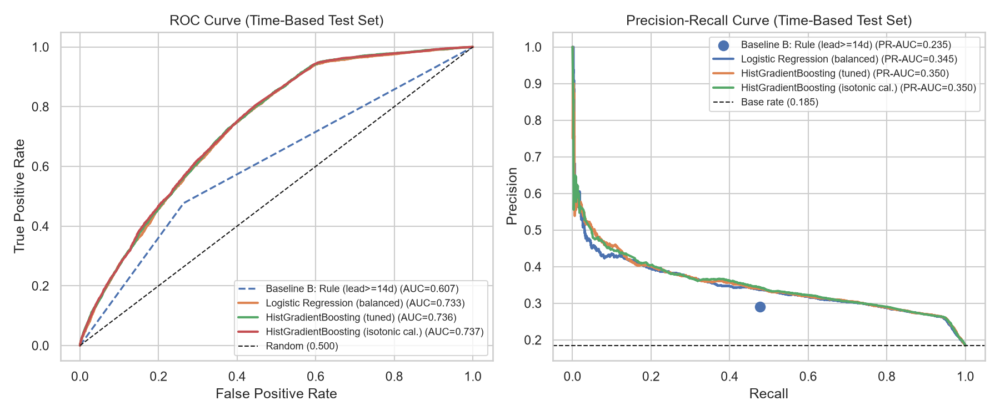
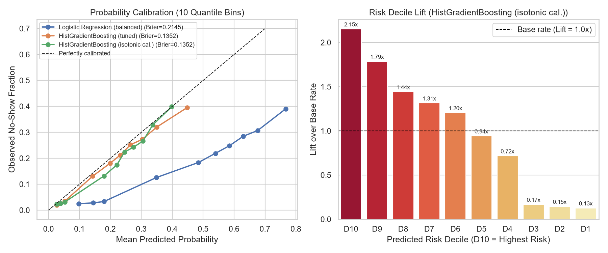

# Hospital Appointment No-Show Prediction

[](https://hospitalah.streamlit.app)  
**Live Demo:** [https://hospitalah.streamlit.app](https://hospitalah.streamlit.app)

An end-to-end, leakage-aware machine learning project predicting outpatient appointment no-shows to help clinic coordinators prioritize **proactive, supportive outreach** (reminder phone calls, easy rescheduling, and transit support) for the top 20% highest-risk appointments.

> **Data Source Notice:** All reported results, figures, and saved artifacts in `models/metrics.json` were generated on the **real Kaggle dataset** (`data/raw/KaggleV2-May-2016.csv`, 110,527 raw rows -> 110,516 cleaned rows). If `data/raw/KaggleV2-May-2016.csv` is removed, the pipeline automatically falls back to `src/make_synthetic.py` and clearly flags outputs as synthetic.

---

## 1. Problem & Operational Framing
Public outpatient clinics experience ~20% missed appointments (`No-show == "Yes"` -> `no_show = 1`). Rather than penalizing patients or denying care, this project scores upcoming appointments so staff can allocate limited outreach capacity:
- **High Risk (Top 20%, score >= 0.3252):** Personal reminder phone call 48h prior + rescheduling/transit assistance.
- **Medium Risk (60th–80th pct, 0.2675–0.3251):** Automated SMS/WhatsApp confirmation with one-tap reschedule.
- **Low Risk (Bottom 60%, < 0.2675):** Standard scheduling workflow.

Why not optimize accuracy? At an ~18.5% test no-show rate, predicting "everyone attends" already gets **81.54% accuracy** while catching **0%** of no-shows. We evaluate models using **PR-AUC**, **ROC-AUC**, **Top-10% / Top-20% Precision, Recall, and Lift**, and **Brier probability calibration**.

---

## 2. Dataset, Cleaning & Leakage Safeguards
- **Source:** Kaggle *"Medical Appointment No Shows"* (Vitória, Espírito Santo, Brazil, Apr–Jun 2016; anonymized IDs, no PII).
- **Cleaning (`src/data_prep.py`, audit in `data/processed/data_cleaning_report.json`):**
  - `110,527` raw rows -> `0` duplicate `AppointmentID`s -> removed `5` rows where `AppointmentDay < ScheduledDay` (negative lead time) -> removed `6` invalid ages (`1` row with `Age == -1`, `5` rows with `Age == 115`, keeping `Age == 0` infants and `Age <= 110`) -> **`110,516` clean rows** (`20.19%` no-show rate across `62,296` unique patients and `81` neighbourhoods).
  - Normalized timestamps to whole days (`AppointmentDay` has no time component), standardized `Hipertension`/`Handcap` typos, and binarized `Handcap > 0` into `has_disability`.
- **Leakage Prevention (`src/features.py`, `docs/DATA_NOTES.md`):**
  - **Primary Time-Based Split:** Train on `2016-04-29` to `2016-05-31` (`84,067` rows, `20.73%` no-show) and test on `2016-06-01` to `2016-06-08` (`26,449` rows, `18.46%` no-show).
  - **Past-Only History:** `prior_appt_count`, `prior_noshow_count`, and `prior_noshow_rate` aggregate daily counts first and include only dates strictly earlier (`<`) than the current `appointment_date`.
  - **Inside-Fold Neighbourhood Encoding:** `NeighbourhoodEncoder` (smoothed target + frequency encoding) fits strictly inside training splits / CV folds.
  - **Patient-Grouped CV Check:** 5-fold `GroupKFold` by `patient_id` verifies generalization to unseen patients with zero patient overlap across folds.

---

## 3. Results (Time-Based Test Set, n = 26,449)

| Model | Operating Rule | Flagged Rate | ROC-AUC | PR-AUC | Brier | Precision | Recall | F1 | Top-10% Lift | Top-20% Recall | Top-20% Lift | Accuracy (Ref Only) |
|---|---|---:|---:|---:|---:|---:|---:|---:|---:|---:|---:|---:|
| **Baseline A: Always Attends** | Always 0 | 0.00% | 0.5000 | 0.1846 | 0.1846 | 0.0000 | 0.0000 | 0.0000 | 1.00x | 20.00% | 1.00x | 0.8154 |
| **Baseline B: Rule (`lead >= 14d`)** | `lead_time >= 14` | 30.31% | 0.6065 | 0.2350 | 0.3117 | 0.2903 | 0.4769 | 0.3609 | 1.57x | 31.46% | 1.57x | 0.6883 |
| **Logistic Regression (`balanced`)** | Train OOF Top-20% (`p>=0.656`) | 19.00% | 0.7328 | 0.3454 | 0.2145 | 0.3527 | 0.3630 | 0.3578 | 2.12x | 37.79% | 1.89x | 0.7595 |
| **HistGradientBoosting (tuned)** | Train OOF Top-20% (`p>=0.330`) | 18.73% | 0.7356 | 0.3500 | 0.1352 | 0.3603 | 0.3656 | 0.3630 | 2.14x | 38.78% | 1.94x | 0.7631 |
| **HistGradientBoosting (isotonic cal.)** | Train OOF Top-20% (`p>=0.325`) | **18.31%** | **0.7368** | **0.3500** | **0.1352** | **0.3655** | 0.3626 | **0.3640** | **2.16x** | **39.38%** | **1.97x** | 0.7662 |

**5-Fold `GroupKFold` Robustness Check (grouped by `PatientId`, full dataset):**
- `Logistic Regression (balanced)`: ROC-AUC `0.7339 ± 0.0018`, PR-AUC `0.3691 ± 0.0045`
- `HistGradientBoosting`: ROC-AUC `0.7390 ± 0.0011`, PR-AUC `0.3789 ± 0.0071`, Brier `0.1426`

---

## 4. Key EDA & Evaluation Figures
All 10 figures are generated by `python -m src.train` into `reports/figures/`:
- **Lead Time (`01_noshow_by_lead_time.png`):** Same-day visits miss only `4.65%` vs `>28–33%` for visits scheduled 15+ days ahead.
- **SMS Confounding (`04_sms_confounding.png`):** Unstratified, SMS looks correlated with *higher* no-shows because 100% of same-day visits receive `SMS_received == 0`. Within advance visits (`lead > 0`), `SMS_received == 1` has lower no-shows (`27.57%` vs `29.44%`). Correlation is not causation.
- **Model Curves & Lift (`07_roc_and_pr_curves.png`, `08_calibration_and_lift.png`):** Isotonic-calibrated `HistGradientBoosting` achieves `2.16x` lift in the top risk decile and well-calibrated probabilities (`Brier = 0.1352`).
- **Error & Fairness Audit (`09_error_analysis_subgroups.png`, `10_fairness_audit.png`):** Balanced across gender (`F`/`M`), while flagging socioeconomic proxy concerns (`Scholarship` and `Neighbourhood`) and lower recall for `60+` seniors.




---

## 5. Limitations, Ethics & Assumptions
- **Assumptions:** `AppointmentDay >= 2016-06-01` represents a realistic future deployment window; `Age > 110` (`5` rows at `115`) are data-entry errors; `Handcap > 0` captures disability status robustly without sparse levels `2–4`.
- **Missing Clinical Context:** No appointment specialty, physician/clinic ID, weather, or visit reason.
- **Responsible AI (`docs/RESPONSIBLE_AI.md`):** `Scholarship` (Bolsa Família) and `Neighbourhood` act as socioeconomic proxies (`Scholarship=1` is flagged at `33.66%` vs `16.67%` for `Scholarship=0`). The model must **never** be used to deny care, charge fees, or penalize patients — only to target supportive reminders and rescheduling help.

---

## 6. Reproduce Everything
```bash
# 1. Create and activate virtual environment
python -m venv .venv
.venv\Scripts\activate      # Windows (or `source .venv/bin/activate` on macOS/Linux)
pip install -r requirements.txt

# 2. (Optional) Verify raw dataset is in data/raw/KaggleV2-May-2016.csv
#    If absent, training automatically generates synthetic data via src/make_synthetic.py

# 3. Run full training, EDA plots, calibration, GroupKFold CV & export metrics.json
python -m src.train

# 4. Run unit & leakage tests
pytest -v

# 5. Execute EDA & modeling notebook
jupyter nbconvert --to notebook --execute --inplace notebooks/01_eda_and_modeling.ipynb

# 6. Launch Streamlit demo app
streamlit run app/app.py
```

---

## 7. Project Structure
```text
├── app/
│   └── app.py                      # Interactive Streamlit risk scoring demo
├── data/
│   ├── raw/                        # KaggleV2-May-2016.csv (or synthetic fallback)
│   └── processed/                  # appointments_clean.csv + data_cleaning_report.json
├── docs/
│   ├── PLAN.md                     # Problem framing, metrics, split & model plan
│   ├── DATA_NOTES.md               # Known pitfalls, cleaning audit & confounding
│   ├── RESPONSIBLE_AI.md           # Fairness audit, proxies, privacy & human review
│   ├── VIVA_NOTES.md               # Reviewer Q&A defense notes
│   ├── DEMO_SCRIPT.md              # 4-minute walkthrough video script
│   └── AI_USAGE.md                 # Transparent AI usage & human review log
├── models/
│   ├── best_model.joblib           # Serialized calibrated pipeline + thresholds
│   └── metrics.json                # All test, CV, tuning & subgroup metrics
├── notebooks/
│   └── 01_eda_and_modeling.ipynb   # Narrative EDA & baseline-to-GBDT notebook
├── reports/
│   └── figures/                    # 10 EDA, calibration, lift, error & fairness PNGs
├── src/
│   ├── make_synthetic.py           # Fixed-seed schema-compatible synthetic generator
│   ├── data_prep.py                # Deterministic cleaning & audit logging
│   ├── features.py                 # Past-only history & inside-fold NeighbourhoodEncoder
│   ├── evaluate.py                 # Metrics, subgroup error/fairness & 10 plots
│   ├── train.py                    # Time split, tuning, calibration & GroupKFold CV
│   └── predict.py                  # Single-record & batch CLI inference
├── tests/
│   └── test_pipeline.py            # Cleaning, leakage & inference unit tests
├── LICENSE                         # MIT License
├── requirements.txt
└── README.md
```
